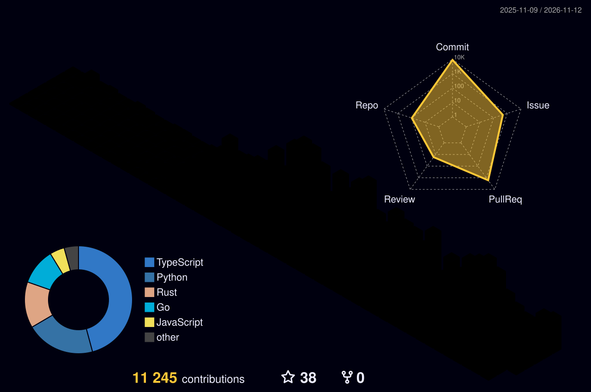

# NolanHo

**LLM infrastructure engineer — Rust + CUDA inference engines, file/storage layers for training data, tooling for agents that operate real machines.**

Research Scientist @ [MindLab-Research](https://github.com/MindLab-Research) · previously SRE @ [DeepSeek](https://github.com/deepseek-ai), storage @ [ByteDance / Volcengine](https://github.com/bytedance) · crypto grad out of [HUST](https://hust.edu.cn)

> Treading stars to exhaust the Truth.

**Start here**

- **[pegainfer](https://github.com/pegainfer-project/pegainfer)** · 730★ — an LLM inference engine in Rust + CUDA. No PyTorch on the box, OpenAI-compatible at the door.
- **[DSH-better-sidebar](https://github.com/omdsh-dev/DSH-better-sidebar)** · 4783★ — an open sidebar where file editing, terminal, Git and sub-agent views are first-class pages, not bolted-on plugins.
- **[curvine](https://github.com/CurvineIO/curvine)** · 1034★ — a CNCF Sandbox project I contribute to: a high-speed cache with file semantics in front of cloud object storage.

**Reach me** — [axi.moe](https://axi.moe) (blog) · WeChat `Nolan-Ho` · [github.com/NolanHo](https://github.com/NolanHo)

## 🔧 Selected Work

**[pegainfer](https://github.com/pegainfer-project/pegainfer)** · 730★ · Rust + CUDA
For teams that have to put a model behind an API without dragging a Python runtime into production: Qwen3 through Kimi-K2, kernels in CUDA, hot path in Rust, and the contract at the edge is the OpenAI API you already speak.
<!-- PLACEHOLDER: 你在 pegainfer 里的确切角色（lead maintainer / 主要作者 / 共建？）写一句，比"参与"有说服力 -->

**[DSH-better-sidebar](https://github.com/omdsh-dev/DSH-better-sidebar)** · 4783★
For people who spend the day inside an agent sidebar: extensions register their own pages and stand on the same footing as the built-in file rendering/editing, terminal, side chat, Git and sub-agent views — so the sidebar is a platform, not a fixed set of tabs.
<!-- PLACEHOLDER: 一句话点出它解决的痛点场景（例如"多个 agent 并行时来回切窗口"），会比现在的功能列表更抓人 -->

**[curvine](https://github.com/CurvineIO/curvine)** · 1034★
For ML teams whose datasets outgrow local disks: cloud object storage gets a file-semantic layer plus a high-speed cache, so training jobs read it like a real filesystem. CNCF Sandbox project — I am a contributor here, not the originator.
<!-- PLACEHOLDER: 你在 curvine 里的具体角色与贡献范围（facts 里只有 1 条 PR，不足以写成维护者） -->

**Upstream & org contributions** — authored PRs: `pegainfer-project` 6 · `omdsh-dev` 10 · `CurvineIO` 1 · `vllm-project` 1 · `tile-ai` 1 · `ray-project` 0. Pinned upstream repos: [vllm](https://github.com/vllm-project/vllm), [ray](https://github.com/ray-project/ray), [tilelang](https://github.com/tile-ai/tilelang).

## 🔥 Spirit

  

Megumin poured her whole life into a single spell, explosion, and refused to diversify. Same instinct here: pick one system, take it apart to the last layer, make it run reliably.

> *何か成す者とは歩み続ける愚者である、成せぬ者とは歩めを止めた賢者である*
> "成一事者，矢志不渝之愚者；毁一事者，停滞不前之贤者"
> —— ロクでなし魔術講師と禁忌教典

💥 Explosion Chant

*黒より黒く　闇より暗き漆黒に* — 比黑色还要黑，暗之漆黑

*我が深紅の混淆を望みたもう* — 融合著我之真红吧

*覚醒のとき来たれり* — 觉醒的时刻已经到来

*無謬の境界に落ちし理* — 坠入无谬之境界

*無行の歪みとなりて* — 形成无形之扭曲

*現出せよ！* — 出现吧！

**Explosion!!**

## 🧰 Also building

- **[rayrust](https://github.com/NolanHo/rayrust)** — a Ray SDK for Rust.
- **[termdeck](https://github.com/NolanHo/termdeck)** — persistent PTY sessions for automation agents, with CLI control and observe-only web replay.
- **[obsharness](https://github.com/NolanHo/obsharness)** — an observability harness that lets an agent search, narrow and inspect a production incident.
- **[DSH-shellout](https://github.com/NolanHo/DSH-shellout)** — runs agent commands in a supervised out-of-process runner, so a hung command can never block the host event loop.
- **[pi-secret-mask](https://github.com/NolanHo/pi-secret-mask)** — keeps secrets out of the model context while still allowing `${secret:...}` references at tool boundaries.

## 📈 GitHub Activity

  <picture>
    <source media="(prefers-color-scheme: dark)" srcset="stats/snake-dark.svg" />
    
  </picture>

Stats card &amp; 3D contribution graph

  

  

---

113 public repos — production infrastructure alongside experiments. The three pinned projects above are where I would start.
